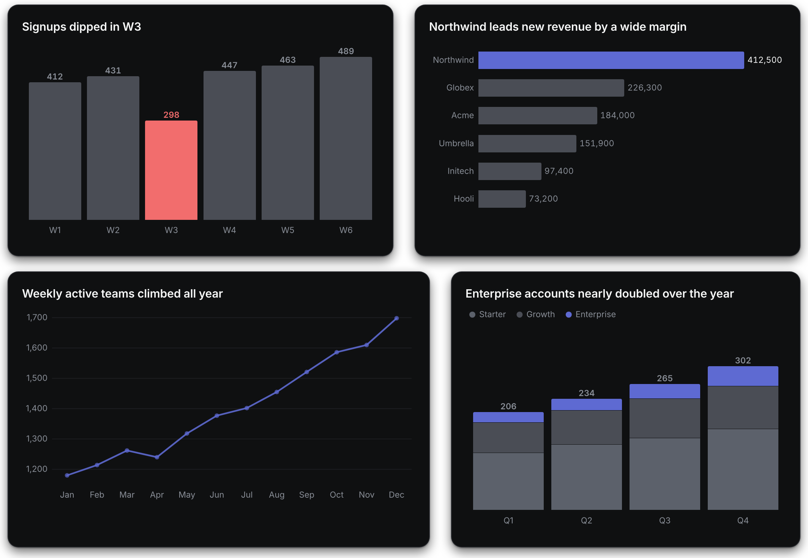
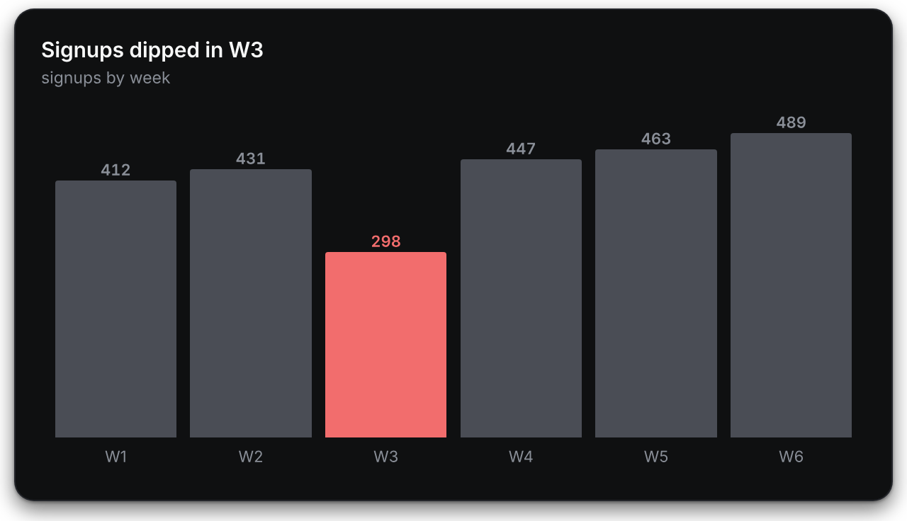

# Tiles

Gallery-quality charts and dashboards inside your terminal, drawn by your AI coding tool.

<p align="center"></p>

Ask Claude Code, Codex, OpenCode or Pi for a chart in plain words. The model sends Tiles a short chart intent, a native Rust engine draws the card with Skia, and the card appears inline in the conversation, Retina-sharp. Everything runs on your machine.

## Install

macOS on Apple Silicon or Intel:

```sh
curl -fsSL https://github.com/tileshq/tiles/releases/latest/download/install.sh | sh
```

The script downloads the release for your Mac, checks its signed checksums, puts `tiles` in `~/.local/bin` and runs `tiles setup`, which finds the coding tools on your `PATH` and asks once before it changes anything. Each [release](https://github.com/tileshq/tiles/releases) also ships an installer package, `tiles-<version>-macos.pkg`; it is not signed by Apple yet, so macOS asks you to allow it once under System Settings, Privacy & Security. [docs/install.md](docs/install.md) has both routes in detail and shows how to check a download by hand.

## Use

```sh
tiles run claude        # or codex, opencode, pi
```

Then ask for a chart: "chart our weekly signups: W1 120, W2 180, W3 150; W3 dipped because of the outage". The card fades in and floats into place, and it stays sharp when you zoom the terminal. Ask for several charts in one go and Tiles lays them out as a dashboard.

<p align="center"></p>

`tiles run` loads Tiles for that session only. After `tiles setup`, plain `claude`, `codex`, `opencode` and `pi` sessions get it too.

## What you get

- Seventeen chart forms: column, bar, grouped, stacked and 100% stacked bars, line and multi-line, area and labelled area, scatter, dot plot, dumbbell, lollipop, slope, bullet, waterfall and a big number. `tiles forms` lists them, each with when to use it.
- Craft built in. The model says what the chart claims and which value to highlight; Tiles picks the sort order, the colours, the labels and the axes. A slip in the intent is corrected and named, and an intent that cannot be drawn right is refused with a one-line fix the model can act on.
- Three themes in the official build: Obsidian, a dark graphite, and tuned light and dark. `tiles theme light` switches, and the model can switch for you with the `tiles_theme` tool.
- Your data stays yours. Rows you type stay in your conversation. With [Omni](docs/omni.md) connected, Tiles fetches the rows itself with your key, and the model sees the chart's title and id, never the values, unless you opt in.
- No telemetry. [SECURITY.md](SECURITY.md) names every connection the binary can open, all at your request, and CI checks on every change that no analytics or crash-reporting crate is linked.

## Terminals

| Terminal | How the card appears |
|---|---|
| kitty, Ghostty, iTerm2 | inline, placed over the reply |
| Warp, WezTerm, VS Code | inline, placed as the reply arrives |
| foot, Windows Terminal | inline, as sixel graphics |
| Terminal.app, Alacritty, GNOME Terminal, tmux | in a companion window beside the terminal on macOS, otherwise as the card's file path |

`tiles doctor` prints the terminal it detected, the route it picked and why, and each coding tool it found. `tiles check` draws a test card so you can see the result before a real session. [docs/surfaces.md](docs/surfaces.md) has the routes and the overrides.

## How it works

`tiles mcp` is an MCP server, and a small add-on per coding tool shows the picture. A chart result carries no image: it asks the model to paste a short placeholder block, every terminal reserves those rows in its own scrollback, and Tiles paints the card over them with the kitty graphics protocol or sixel. The engine draws text as glyph outlines at 2x, so cards are crisp on any display. Every byte that reaches the terminal passes one sanitizer, and a hostile corpus runs through every output path in the tests. Each decision has a record in [docs/adr/](docs/adr/README.md).

## Build from source

```sh
cargo build --release -p tiles-cli
./target/release/tiles render crates/tiles-engine/tests/intents/column.json -o column.png
```

The build needs the Rust toolchain in `rust-toolchain.toml` and fetches a prebuilt Skia that `scripts/skia-binaries.sha256` pins. A build from source draws a plain theme of its own; the house design pack ships only in official releases, under its own licence. [CONTRIBUTING.md](CONTRIBUTING.md) lists every check CI runs.

## Contributing

Bug reports, chart form requests and requests for a terminal or coding tool are welcome through the issue templates. Pull requests are too; the first one asks you to accept a short contributor agreement once. Read [CONTRIBUTING.md](CONTRIBUTING.md) first, and report a security problem privately as [SECURITY.md](SECURITY.md) says.

## Licence

Tiles is source-available under the Functional Source License, [FSL-1.1-ALv2](LICENSE). You can read, run, change and use it, inside your company included; you cannot sell or host a competing product made from it, and each version becomes Apache-2.0 two years after its release. The house design pack in official releases is under the [Tiles Design Licence](LICENSE-design). Inter is bundled under the SIL Open Font License. The name is covered by [TRADEMARKS.md](TRADEMARKS.md).
